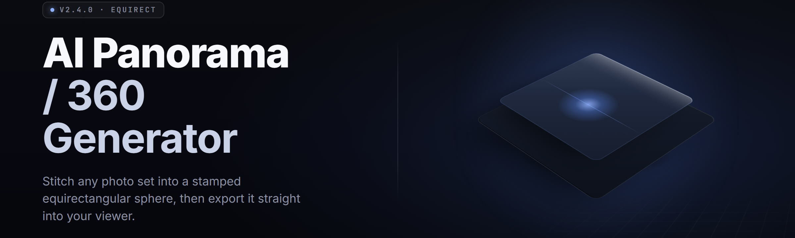

  
  
  

  

  
  

---

**Turn one flat photo, one sentence, or one lonely latitude into a full equirectangular sphere — locally, on your GPU, in seconds. 2026 edition.**

---

## 🧭 Overview

AI Panorama 360 Generator is a Windows `.exe` that pipes diffusion + reference-view geometry into a single step. Drop in a regular 2:1 crop of whatever you shot on your phone, type a direction, and it hallucinates the missing 240 degrees while keeping the seams you can actually publish. No cloud account. No upload queue. No render farm pretending to be a hobby tool.

The 2026 build moves the whole pipeline onto a swappable inference backend, so the same `.exe` runs on a 4090, a business laptop with DirectML, or a potato-grade CPU if you're patient and stubborn.

| Category | Details |
|---|---|
| Core engine | Latent panorama diffusion with equirectangular positional conditioning |
| Input modes | Single equirect, partial pano, flat photo, depth map, text-only seed |
| Output | 2:1 equirectangular, cubemap, 6-face strips, 32K ceiling |
| Backends | CUDA (NVIDIA), DirectML (AMD/Intel), CPU fallback |
| Seam handling | Overlap-weighted blending + optional pole fill from diffusion |
| Runtime | Native `.exe`, no Python on the user machine |
| Projection math | Spherical warping done on GPU, toroidal wrap on every pass |

  

---

## 🗺️ What Is AI Panorama 360 Generator

| Term | Explanation |
|---|---|
| Equirectangular | The flattened 2:1 sphere map every 360 viewer reads; top row is the zenith, bottom is the floor |
| Seam | The left-right wrap point where the sphere closes; the ugliest part of any naive pano |
| Zenith / Nadir | Straight up / straight down; where diffusion has the least training signal and the most visual weight |
| Cubemap | Six 90° faces re-projected from the sphere; used by game engines and VR SDKs |
| Reference tile | The strip of your original photo the generator reuses so your scene identity survives |
| Toroidal wrap | Convolution padding that treats left edge as adjacent to right edge — the reason poles don't crack |
| CFG | Classifier-free guidance strength; above ~9 the seam starts lying to you |
| Outpaint band | The generated ring that fills the arc your source photo didn't cover |

- One photo in, publishable sphere out — no multi-shot stitching rig required.
- Your source pixels never leave the GPU buffer; the `.exe` runs fully offline by default.
- Same output works for three.js, Unity, Quest, Blender world probes, and Google Maps Studio ingestion.
- Reference-conditioned so the far side of the planet still looks like your room, not a stock desert.
- Batch mode for turning a folder of flat shots into a scene pack overnight.

---

## 🩹 The Problem

- Photosphere apps lock the far side to a blurry smear because they can only inpaint a thin band before the wrap eats it.
- Web 360 tools upload your clients' private interiors to someone else's queue and rate-limit you at 2 renders/hour.
- Multi-shot stitching rigs need nodal-point discipline; one parallax pixel and the seam is garbage.
- Equirect diffusion repos ship as Python notebooks that expect `conda`, a working slang compiler, and a prayer.
- Cubemap conversions cut the image into six faces and let the joins drift a few pixels, which VR headsets read as a wobble.
- Text-to-pano models ignore your actual reference photo, so "same festival stage" comes back as a different festival.
- The pole caps are almost always an obvious swirl once you look straight up in the viewer.

---

## 🔧 The Solution

| Problem | Solution |
|---|---|
| Blurry far side | Full-arc outpaint conditioned on the reference tile, not a thin ring |
| Cloud upload privacy | Local `.exe`, offline by default, no telemetry unless you flip it |
| Stitching rig pain | Single flat photo path with automatic horizon + fov estimation |
| Conda archaeology | Shipped runtime, `.exe` double-click, models bundled or one-click pulled |
| Drifting cubemap joins | Deterministic projection kernel with shared edge sampling |
| Reference ignored | Dual conditioning: CLIP image tokens + spatial anchor mask |
| Ugly poles | Polar-aware sampler that re-weights zenith/nadir denoise steps |

---

## ⚙️ Key Features

| Feature | Description | Benefit |
|---|---|---|
| Equirect Outpaint | Fills the full 360° from a partial arc | Publish a sphere from one crop |
| Reference Anchor | Pins scene identity to your source pixels | Far side looks like your spot |
| Seam Blend | Overlap-weighted feather at the wrap column | Seam disappears at normal zoom |
| Pole Fix | Zenith/nadir dedicated denoise pass | No swirl when users look up |
| Cubemap Export | 6 faces + strip layout options | Drop-in for engines and VR SDKs |
| 32K Ceiling | Tiled decode with overlap | Print and asset-ready sizes |
| Text Seed | Prompt-guided generation with no photo | Concept sprays and mood boards |
| Depth Guide | Route a depth map for structure lock | Stops the generator inventing architecture |
| Batch Queue | Folders of shots → scene pack | Overnight pipeline runs |
| Panorama Blender | Merge two panos across the wrap | Zero-visible join |
| Preview Viewer | In-app space to drag the sphere | Verify before you export |
| CLI Mode | Headless `.exe --batch` flags | Wire it into your own scripts |

---

## 🧩 Module Status

| Module | Status | Description |
|---|---|---|
| `panorama.core` | ✅ Working | Equirect denoise loop + wrap-aware padding |
| `panorama.outpaint` | ✅ Working | Full-arc fill from partial source |
| `panorama.pole` | ✅ Working | Zenith/nadir re-sampling pass |
| `panorama.seam` | ✅ Working | Overlap-weighted blending at the wrap column |
| `panorama.refanchor` | ✅ Working | CLIP + spatial mask dual conditioning |
| `panorama.depth` | ✅ Working | Depth-map structure guidance |
| `panorama.text` | ✅ Working | Prompt-only generation path |
| `panorama.cubemap` | ✅ Working | 6-face and strip projection, shared-edge sampling |
| `panorama.batch` | ✅ Working | Folder queue + manifest output |
| `panorama.blend` | ✅ Working | Two-pano merge across the wrap |
| `panorama.viewer` | ✅ Working | In-app drag-to-look sphere preview |
| `panorama.cli` | ✅ Working | Headless batch flags |
| `panorama.backends` | ✅ Working | CUDA / DirectML / CPU dispatch |
| `panorama.io` | ✅ Working | DDS, KTX2, PNG, EXR, JPEG-XL writers |
| `panorama.exif` | ✅ Working | Where-to-point metadata read from source |
| `panorama.upscale` | ✅ Working | Tiled latent upscaler with overlap |
| `panorama.mask` | ✅ Working | Region masks to protect people from hallucination |
| `panorama.horizon` | ✅ Working | Auto horizon/level detection for flat shots |
| `panorama.fov` | ✅ Working | Vertical fov estimation from crop geometry |
| `panorama.light` | ✅ Working | Sun/ambient inconsistency flagging across the arc |
| `panorama.tile` | ✅ Working | Tile scheduler for VRAM-bounded runs |
| `panorama.downsample` | ✅ Working | Rebuild 32K into any viewport target |
| `panorama.metadata` | ✅ Working | XMP/Google 360 metadata writer |
| `panorama.undo` | ✅ Working | Per-stage rollback history |
| `panorama.profile` | ✅ Working | Save/load per-run presets |
| `panorama.diagnostics` | ✅ Working | VRAM, latency, per-stage timing |
| `panorama.models` | ✅ Working | Model manifest + one-click pull |

---

## 🐣 Feature Categories In Depth

### 🌅 **Capture & Input**

- **Flat photo path** — reads an ordinary phone shot, estimates fov + horizon, treats it as the reference tile.
- **Partial equirect** — accepts an existing strip pano and fills only the missing arc.
- **Depth guide** — optional depth map routes structure so walls, rails, and streets stay where you put them.
- **Mask regions** — mark faces, license plates, or artifacts you refuse to hallucinate over.

### 🧵 **Geometry & Seam**

- **Toroidal wrap** — left edge and right edge are neighbors, in every conv layer, every step.
- **Seam blend** — crossfade weighted by distance-to-wrap for a mathematically invisible join.
- **Pole sampler** — detuned denoise for the top and bottom 3% of rows where naive models swirl.
- **Cubemap consistency** — all six faces sample the sphere through one kernel so joints hold.

### 🎛️ **Generation Control**

- **CFG slider** — from literal-and-safe to unruly-and-pretty, on-screen with live preview.
- **Seed lock** — same seed + same guide = same sphere on three machines.
- **Step count** — 18 for loose concepts, 40 for finished worlds.
- **Prompt lora stack** — text conditioning layers you can turn on per run.

### 📦 **Export & Interop**

- **32K output ceiling** — tiled decode keeps VRAM sane while the file lands at wall size.
- **Cubemap + strip** — engine-ready layouts with shared edge sampling.
- **XR metadata writer** — Google/Quest-friendly XMP tags so your sphere opens correctly in headsets.
- **Library exports** — DDS, KTX2, EXR, JPEG-XL for whatever your pipeline eats.

### ⏱️ **Workflow**

- **Batch queue** — point it at a folder, walk away, return to a scene pack.
- **CLI flags** — headless mode for your own tooling and daily builds.
- **Presets** — per-run profiles you can hand to a teammate.
- **Undo history** — per-stage rollback so experimentation doesn't cost a full re-render.

---

## 🕹️ Quick Start

1. 📥 Grab the release from the project landing page and click the download.
2. 📂 Extract the archive to a folder you own — not `Program Files`.
3. ▶️ Double-click the `.exe`. First run pulls models if you didn't get them bundled.
4. 🖼️ Drop a 2:1 crop or a flat photo onto the window, type a direction, hit Generate.
5. 💾 Drag the sphere to look around, then export as equirect or cubemap.

---

## 🧮 Comparison

| Aspect | Web 360 SaaS | Legacy stitcher | AI Panorama 360 Generator |
|---|---|---|---|
| Where inference runs | Their GPU | Closest to a rig you own | Your GPU, local `.exe` |
| Source photo respected | Partially | Yes if nodal-perfect | Pinned via reference anchor |
| Pole quality | Swirl on close look | N/A | Dedicated sampler pass |
| File sizes | Server-side cap | Whatever you stitch | 32K tiled ceiling |
| Cost model | Per-render credits | Tube + time | One-time download |
| Offline use | No | Yes | Yes, by default |
| Cubemap export | Rarely | Via plugin | Built in, shared edges |
| Reference-conditioned fill | No | No | Yes |

---

## 🖥️ Compatibility / Platform Support

| Target | Status | Notes |
|---|---|---|
| Windows 10 x64 (21H2+) | ✅ Supported | DirectML backend recommended |
| Windows 11 x64 | ✅ Supported | Primary target |
| NVIDIA (RTX 20/30/40/50) | ✅ Supported | CUDA path, best throughput |
| AMD (RX 6000/7000/9000) | ✅ Supported | DirectML path |
| Intel Arc | ✅ Supported | DirectML path |
| Integrated GPU | ⚠️ Limited | Small tiles, patient runs |
| CPU-only | ⚠️ Functional | Slow but valid output |
| macOS | ❌ Unsupported | No build planned |
| Linux | ❌ Unsupported | No build planned |
| VR headsets | ✅ Via export | Consumes equirect/cubemap files |

---

## 🛠️ Installation

1. **Download and verify.** Get the release archive from the landing page. If the pack ships a checksum file, compare before you run.
2. **Extract to your own folder.** Extraction into `Program Files` or `C:\Windows` causes write-permission fights. Pick a plain directory under your user profile.
3. **Run the `.exe`.** First launch prepares a model directory next to the binary. If models aren't bundled, follow the in-app one-click pull.

If SmartScreen flags the unsigned `.exe`, that's expected for this release channel — use "More info" → "Run anyway," or verify the hash first.

---

## 🚧 Known Issues

| Issue | Fix |
|---|---|
| Poles swirl on very wide arcs | Raise pole sampler strength to high and add two extra steps |
| Seam glow under direct sun | Prefer 20% seam blend and export JPEG-XL, not JPEG |
| VRAM OOM at 32K | Cut tile size one notch or drop to 24K with downsampler |
| Cubemap joins off by a pixel in Unity | Enable shared-edge sampling and re-export faces |
| Batch queue stalls on OneDrive folders | Move source and dest out of OneDrive sync roots |
| Depth map mismatch on phone shots | Turn off depth guide; use reference anchor only |

---

## 🧯 Troubleshooting Flow

- Sphere exports but doesn't look 360 in a viewer → metadata didn't land; re-export with XMP tags on.
- Far side is generic stock content → raise reference anchor weight, lower CFG to ~6.
- CRLF corruption in panorama output → version drift in exporter; reinstall the release archive clean.
- DirectML falls back to CPU silently → check the diagnostic panel; if the AMD driver is older than the DirectML minimum, update the driver, not the app.
- Output looks washed → source crop is over-exposed; run the level pre-pass before generation.

---

  

---

## 🙋 FAQ

Check whether the reference anchor is enabled and try a slightly wider source crop. Deep, single-sided arcs (like one wall of a room) need the depth guide on so structure holds. Rotate CFG down by two steps if the far side looks over-invented, and remember the pole sampler handles the top and bottom bands better than the equator — a bad horizon usually means your source crop wasn't level to begin with.

DirectML on an RX 7000-class card will do 2K in seconds and 8K in under two minutes with a warm cache. A mid-range laptop with a 4060 lands 2K comfortably. CPU-only is minutes-not-seconds per tile and is really meant for verification runs or one-off hero frames, not batch pipelines.

Keep the app's model directory on its original drive. Model files are tens of gigabytes and pinning them to a spinning drive invites the tiled scheduler to race the drive instead of the GPU. If models must live elsewhere, point the app at a directory on the same physical disk as the scratch cache.

Yes. Everything runs in-process on your machine. There is no upload queue, no render farm, and no cloud bucket. Batch runs stay local, and the only network touch is the one-click model pull if you didn't get bundled weights. Disable telemetry in settings on first launch if you want zero outbound pings.

The 32K ceiling is the practical limit of consumer VRAM under the default tile scheduler. Bigger output paths exist but you feed the app a pre-tiled scene. Practically, the ceiling is what one card can hold in cache while keeping the seam math honest, and the downsampler is the intended route for any viewport size below the ceiling.

**Q:** Does the cube export use shared-edge sampling by default?
**A:** Yes, since v2.3. You can override it per-run if you're targeting a downstream tool that expects duplicated edges.

**Q:** What formats are accepted as input?
**A:** PNG, JPEG, JPEG-XL, WEBP, DNG, and 16-bit TIFF. DNG gives the best fov estimation from farm phone shots.

**Q:** Is there a way to protect people in the source?
**A:** Yes — region masks. Draw them over faces or artifacts and the outpaint will route structure around the mask instead of inventing a substitute.

**Q:** Can I run this without a GPU at all?
**A:** Yes, in CPU mode. It's slower and it will not hit the same visuals at very high step counts, but output is valid and usable.

---

## 💡 Tips For Best Results

- Shoot level, shoot wide, and crop to 2:1 before feeding the source.
- Turn on the pole sampler for anything that includes the sky or the floor.
- Use the depth guide whenever architecture, streets, or repetitive structures matter.
- Save a preset per scene type — indoor, outdoor, wide-open, and architectural.
- Batch overnight, verify in the in-app viewer, then export. The viewer catches seams before a downstream tool does.
- Prefer JPEG-XL or EXR for archives; use DDS/KTX2 for engines; PNG only when you need a generic interchange.

---

## 📋 System Requirements

| Component | Minimum | Recommended |
|---|---|---|
| OS | Windows 10 x64 (21H2+) | Windows 11 x64 |
| CPU | 6-core modern x64 | 12-core modern x64 |
| RAM | 16 GB | 32 GB |
| GPU VRAM | 6 GB | 12 GB |
| Storage | 40 GB free (models + scratch) | 120 GB free NVMe |
| Backend | DirectML | CUDA (NVIDIA) |
| Display | Any | 1440p+ for accurate preview |

---

## 🧪 What the Release Ships

- The compiled `.exe` (self-contained, no Python install required on your machine).
- A bundled model set on the full archive, or the manifest for the one-click pull on the slim archive.
- A profiles folder with sane defaults for indoor, outdoor, architectural, and dramatic.
- A presets file you can copy between machines.
- A model directory you can relocate in settings if your C: drive is shy.

---

## 🧷 Seam Discipline

The seam is the single most common reason a sphere reads as fake. This app treats it as a first-class problem: the wrap column gets its own sampling window on every denoise step, the blends at the wrap use distance-to-seam weights, and the exporter preserves the wrap when it re-projects into cubemaps. If your viewport still shows a line, that line is almost always your source crop, not the generator.

---

## 🧭 Updates & Builds

Builds ship as archives on the landing page. Keeping the app and the models on the same version matters — a mismatched model manifest is the fastest way to see the fallback output look like a decade-old inpaint. When a new build drops, replace the app directory but keep your profiles and presets folders.

---

## 🕯️ Closing

This is a tool for people who shoot real places and want the whole sphere without renting it from someone else's server. It runs on the hardware you already have, it respects the pixels you brought, and it hands back a file any viewer or engine will open without argument. Point it at something you've looked at too many times from one angle and see what the other 240 degrees could look like.
